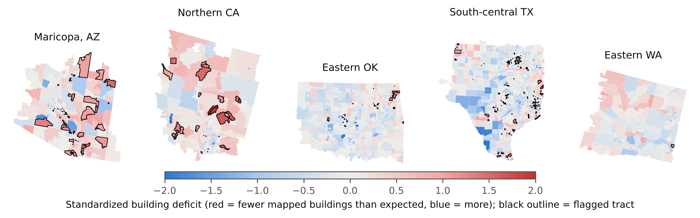

# Invisible Exposure

**Reference-free, conformal auditing of open-map completeness and the climate-hazard exposure it hides.**

[](https://github.com/GTX-Pradeep/invisible-exposure-open-map-equity/actions/workflows/tests.yml)


Climate-risk tools count exposed buildings by overlaying heat, wildfire and drought layers on open maps. A building that is missing from the map is missing from the risk count. This project estimates, for **9,794 census tracts** in five U.S. hazard regions, how many buildings and points of interest Overture Maps *should* contain. It puts a calibrated 90% range around each estimate, flags tracts that fall below it, converts the gaps into hidden climate-hazard exposure, and audits, under a pre-registered plan, who lives there and whether the gaps close across releases.

<p align="center"></p>

## Key results

| Question | Finding |
|---|---|
| Are the uncertainty ranges honest? | 90.0% coverage of a 90% target under spatial cross-fitting; 84.6% when a whole region is held out, restored per region by within-region calibration |
| Do flags find real gaps? | 5.1x lift over chance against FEMA/ORNL USA Structures; a 50% loss is detected in 96% of tracts |
| Is the model better at ranking than simpler methods? (exploratory) | No: with the same 510-flag budget, seven other methods reach 4.0-5.3x lift (Isolation Forest 5.3x) and none differs significantly. The value is calibrated ranges and release monitoring |
| Did the map catch up? (pre-registered) | Tracts below 80% of the reference fell from 7.0% (2023) to 1.8% (2026-08); rural tracts improved 9.9 percentage points more than urban |
| Did anything go wrong? (exploratory) | From release 2026-09-23 on, Overture dropped about 179,000 buildings in 186 San Antonio tracts (889,000 residents, 63% high-vulnerability). The reference-free model flagged 82% of them |
| Who bears hidden exposure? (pre-registered) | Missing structures in high-wildfire tracts are 4.8x more common per home in rural than urban tracts (robust to 4 alternative hazard definitions, 3.8-6.3x); drought 2.9x (weaker within regions) |
| Do machine-learned imports fail in other ways? (exploratory) | The dropped San Antonio buildings were Microsoft footprints (79% of a tract's buildings on average vs 38%). Where Microsoft supplies at least 90% of buildings (1,854 tracts, 7.3M people), only 1.0% of buildings carry a use class vs 24.9% elsewhere, and no geometric check detects it |
| What can't the method see? | Tract flags miss modest, group-wide gaps: the model absorbs 64-80% of the rural and tribal shortfall, and its error is larger than a 20% gap |

Full write-up: [`paper/main.pdf`](paper/main.pdf). Course report (IEEE format): [`deliverables/IEEE_Report.pdf`](deliverables/IEEE_Report.pdf).

## Method

```
 Overture buildings/places ─┐                          ┌─> Validation (USA Structures, Business Patterns, deletion test)
 Census ACS + LODES jobs ───┼─> tract table ─> expectation model ─┼─> Equity audit (SVI, CVI, rural, tribal, hazards)
                            │   (structural      + conformal range └─> Catch-up across 3 releases (2023, 2026-08, 2026-10)
 Audit strata ──────────────┴── joined only at the audit, never a model input
```

* **Expectation model:** LightGBM quantile regression on log counts using structural covariates only (housing stock, population, land area, jobs). `assert_no_leakage` refuses vulnerability, rurality, tribal, hazard, reference and outcome columns.
* **Calibrated ranges:** conformalized quantile regression (CQR), cross-fitted over 50 km spatial blocks so a tract's own deficit never lowers its expectation; optional within-region (Mondrian) calibration.
* **Audit:** hypotheses frozen in [`docs/preregistration.md`](docs/preregistration.md) before any equity result was seen. County-clustered inference, Benjamini-Hochberg FDR across 25 tests, robustness runs, and the original template tested as worded.

## Quickstart

```bash
git clone https://github.com/GTX-Pradeep/invisible-exposure-open-map-equity.git
cd invisible-exposure-open-map-equity
python -m venv .venv && source .venv/bin/activate
pip install -e ".[dev]"
pytest -q                      # unit tests (synthetic data, ~5 s)
bash scripts/run_all.sh        # full pipeline from public data (~1.5 h on 4 cores)
```

For a guided tour without rerunning ingestion, open [`notebooks/Invisible_Exposure.ipynb`](notebooks/Invisible_Exposure.ipynb); for the exploratory data analysis, [`eda/`](eda/README.md) (five notebooks, raw files first). To download the data and run everything on Windows, follow [`docs/DATA_DOWNLOAD.md`](docs/DATA_DOWNLOAD.md). DuckDB installs its `httpfs` and `spatial` extensions on first use. LaTeX (texlive + latexmk) is needed only to build the PDFs.

## Pipeline

| Phase | Script | Output |
|---|---|---|
| Data | `fetch_challenge.sh`, `fetch_inputs.sh`, `00b_usa_structures_counts.py`, `00c_poi_reference.py` | raw inputs, reference counts |
| 1 | `01_count_overture.py --release r2026a \| r2026b \| r2023` | per-tract counts and source provenance |
| 2 | `02_build_tract_table.py` | model table (schema checks in `coverage_risk/checks.py` run before saving); audit strata kept in a separate file |
| 2 | `13_data_dictionary.py` | `docs/DATA_DICTIONARY.md`: every column of the model table |
| 3 | `03_expectation_model.py` | expected count, 90% range, flag, shortfall |
| 4 | `04_validation.py` | CV schemes, reference skill, deletion test |
| Gate | `docs/preregistration.md` | frozen before Phases 5-7 |
| 5-7 | `05_provenance.py`, `06_audit.py`, `06b_fdr.py`, `06c_robustness.py`, `06d_original_hypotheses.py`, `07_catchup.py` | H1-H5, FDR, robustness |
| Expl. | `09_exploratory.py` | release regression, absorption, H3 sensitivity |
| Merged | `11a_import_merged.py`, `11_merged_exploratory.py`, `16_relative_rmse.py`, `12_merged_numbers.py`, `15_review_checks.py` | N1-N5 ([`docs/merge_results.md`](docs/merge_results.md)). Only `11a` needs `../MapEquityChallenge`; its output (`data/external/merged_inputs.csv`) is committed with SHA-256 hashes of its sources, so every later step runs from this repository alone |
| 8 | `08_figures.py`, `10_paper_numbers.py` | figures; every number in the paper is generated |

A clean rerun from this repository reproduces `paper/numbers.tex` and every result table byte-for-byte.

## Data

All inputs are public: Overture Maps (releases 2023-07-26-alpha.0, 2026-08-19.0, 2026-10-21.0), the Bias Bounty: Mapping Equity challenge extracts and strata, ACS 2020-2024, LODES 2022, FEMA/ORNL USA Structures, and Census Business Patterns 2023. Versions, links, licences and an independence check are in [`docs/data_sources.md`](docs/data_sources.md); processed tract-level results with a data dictionary are in [`deliverables/dataset/`](deliverables/dataset/).

## Repository layout

```
config/config.yaml          all settings (regions, releases, model, conformal, merge)
src/coverage_risk/          library: db, aggregate, features, provenance, checks, model, validation, audit
scripts/                    one numbered script per phase; run_all.sh runs them in order
  00b-02                      data: reference counts, Overture counts, tract table
  03-04                       model and validation
  05-07, 06b-06d              pre-registered audit (H1-H5), FDR, robustness, original hypotheses
  08, 10                      figures and paper numbers
  09                          exploratory E1-E3 (release regression, absorption, H3 sensitivity)
  11a, 11, 12                 merged-project exploratory N1-N5 and their paper numbers
  13                          data dictionary
  fetch_data.ps1              Windows: download everything (see docs/DATA_DOWNLOAD.md)
tests/                      unit tests (run in CI)
data/
  raw/                        downloads (not in git; see docs/DATA_DOWNLOAD.md)
  processed/                  pipeline intermediates (not in git)
  external/merged_inputs.csv  per-tract fields imported from MapEquityChallenge (comparison data only)
eda/                        exploratory data analysis, in build order (see eda/README.md)
  00-02_raw_*.ipynb           the raw files: inventory, Overture, census inputs
  03_aggregation_and_table_checks.ipynb   tract assignment and tract-table checks, reproducibility
  04_tract_table_eda.ipynb    the assembled tract table
  tables/, figures/           saved outputs
modelling/                  model checks, build steps 7-8 (see modelling/README.md)
  01_model_settings.ipynb     where each setting comes from, exact reproduction, sensitivity to 16 variants
  02_residual_diagnostics.ipynb  residuals: calibration by tract size, drift, spatial clustering vs 50 km blocks
notebooks/
  Invisible_Exposure.ipynb    guided walkthrough of the whole pipeline (course code deliverable)
  build/make_notebook.py      generates the walkthrough
docs/
  DATA_DOWNLOAD.md            what to download, from where, in what order (Windows commands)
  data_sources.md             versions, licences, independence check
  DATA_DICTIONARY.md          every column of the tract model table (role, source, meaning, unit, missing, range)
  preregistration.md          frozen pre-registration with deviations (+ the original 2026-10-16 template)
  merge_results.md            results of the merged exploratory analyses N1-N5
outputs/
  tables/                     pre-registered and E1-E3 result tables (CSV/JSON)
  tables/merged/              N1-N5 result tables, merged.json, N-family FDR
  figures/                    all figures (PNG/PDF)
paper/                      manuscript: main.tex/.pdf; numbers.tex and numbers_merged.tex are generated
deliverables/               course deliverables: one-pager, slides, documentation, IEEE report (ieee/), dataset/
  build/                      Node scripts that generate the .docx and .pptx files
```

## Limitations

USA Structures and Overture's machine-learned footprints are both imagery-derived, so shared omissions would understate gaps. The POI reference is allocated to tracts by area. Hazards are tract averages. The 2023 snapshot is an archived alpha copy. The five regions are not a national sample. See Section 6 of the paper.

## Citation

Use GitHub's **Cite this repository** button ([`CITATION.cff`](CITATION.cff)), or:

> Pradeep T, Prajwal A, Nikhita P Uppar and Sakshi Kiran (2026). *Invisible Exposure: Reference-Free Conformal Auditing of Open-Map Completeness and Hidden Climate-Hazard Exposure.* https://github.com/GTX-Pradeep/invisible-exposure-open-map-equity

## License

Code is MIT-licensed (see [`LICENSE`](LICENSE)). Derived data inherit their sources' licences: Overture buildings ODbL, places CDLA-Permissive-2.0; U.S. government data are public domain.
